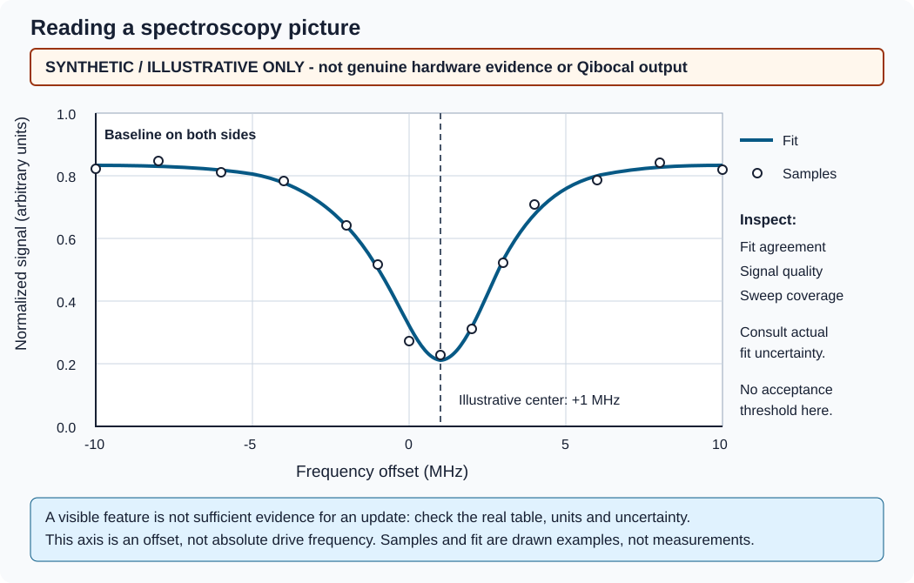

Artifacts and report inspection
===============================

Where files live
----------------

Both direct and queued execution collect one standard Qibocal report per MCP
session under ``OUTPUT/sessions/<session_id>/``. With default settings this is
``~/.local/share/qibocal/agents/runs/default/sessions/<session_id>/`` on the execution
host (``runs/NAME`` for a named configuration). Each execution has a dedicated
``data/<protocol>-<iteration>/`` directory; repeated protocols get new iterations
rather than overwriting earlier runs. Discovery alone does not create a report.
``start_session`` switches the active agent to a fresh report folder and saves
its selected baseline immediately. It does not restart the conversation or
modify earlier reports. See :doc:`../reference/mcp` for selectable starting points.

With SSH, these paths are on the cluster, not on the laptop. Results and images
return over MCP, but copying the remaining files is a separate operation.
Use the returned ``folder`` (protocol artifacts) and ``report_folder`` (whole
session report), or final agent summary, rather than guessing IDs.

A session report contains, depending on protocol support and execution success:

.. code-block:: text

   <session_id>/
     meta.json
     history.json
     notes.json                # append-only session comments
     session.json              # selected baseline provenance, for start_session
     platform/                 # initial session platform, never overwritten
     new_platform/             # current session platform
     edits/
       <edit_id>/
         edit.json             # explicit pointer/value edits
         parameters.json       # immutable accepted edit snapshot
         calibration.json
     data/
       <protocol>-0/
         action.yml
         run.json
         notes.json            # comments for this exact protocol iteration
         ... protocol data files ...
         ... fitted results files, if present ...
         report-0-0.html
         report-0-0.png
         report-0-0.json   (Plotly figure, when light enough for the plot view)
         ... more target/figure report files, if present ...
         execution_platform/   # immutable state after acquisition/fit, before update
           parameters.json
           calibration.json
         platform/             # immutable snapshot after an accepted update
           parameters.json
           calibration.json
       <protocol>-1/
         ...

``meta.json`` records Qibocal/backend versions, the start time, the latest
successful operation's end time, accumulated targets and per-execution acquisition
and fit timings. ``history.json`` retains execution order across protocols and
iterations, including across fresh SLURM workers. Each ``action.yml`` records
the protocol, targets and resolved parameters, including platform defaults;
its update flag becomes true only after an accepted update.
``new_platform/`` initially matches ``platform/`` and is refreshed as successful
executions and accepted updates change the live session state.
Serve ``OUTPUT`` with ``qibocal-agent report`` to discover these session reports,
or, from an interactive assistant, ask it to open the reports: see
:ref:`browse-reports`.

``append_note`` stores session plans/summaries or per-run findings as Qibocal
notes with content, UTC timestamp and optional caller-supplied author.
``get_notes`` reads them; follow-up comments preserve earlier conclusions.
Regular protocol execution leaves histories empty until comments are supplied.
Notes survive later acquisitions, updates, edits and fresh SLURM workers.
New sessions start empty and leave old report histories unchanged.
Author labels from MCP are not authenticated identities. The report viewer
provides display and permission-controlled editing separately.

Data and fitted-result filenames are owned by the pinned Qibocal protocol and
serializer; they are not a single universal schema. Report indices enumerate
targets and figures, not necessarily the target's literal qubit ID.
The bridge consumes ``Protocol.report`` output through ``Executor.report``:
Plotly figures and HTML tables, not a full Qibocal HTML report-page template.
Saved HTML files are individual interactive Plotly figures. PNGs are exported at
1200 by 700 pixels using Kaleido/Chrome on the execution host.

Run metadata
------------

``run.json`` and the structured execution response include:

* ``run_id``, ``platform`` and ``slurm_job_id`` (possibly null).
* ``session_id`` and ``report_folder`` for the shared Qibocal report.
* ``protocol``, submitted ``parameters`` and selected ``targets``.
* ``platform_overrides``: submitted trial edits, or null for ordinary executions.
* ``folder`` on the execution host.
* Serialized fitted ``results``, or null when absent.
* ``supports_update``, ``updated`` and ``update_started``.

These are records of the run, not an automatic fit-quality verdict.
The initial execution response reports update flags as false; a later update
modifies the saved metadata rather than rewriting the previous MCP response.
An attempted update may leave ``update_started`` true and ``updated`` false.
See :doc:`safety` before recovering from this situation.

MCP images and evidence
-----------------------

The server returns report tables as text and PNG reports as **MCP image
content**, not merely paths. A vision-capable client can inspect the images
without mounting cluster storage. A protocol without reports or fitted
results may return fewer content blocks.

The Pydantic AI agent consumes those inline images unchanged; interactive MCP
clients display them according to their own capabilities. If your interface
drops inline MCP images, stop rather than deciding updates from text alone;
see :doc:`safety`.

.. _browse-reports:

Interactive plots for you
-------------------------

The images serve the model. To explore the same figures yourself — zoom,
hover, toggle traces — there are two ways, depending on the interface:

* **Inline**, in chat interfaces supporting MCP Apps (for example VS Code
  GitHub Copilot): each ``execute_protocol`` call shows the run's
  interactive figures next to it. Nothing to configure. Terminal assistants,
  such as Copilot CLI and Claude Code, do not display them.
* **In the browser**, in any interface: ask the assistant to *open the
  reports*. Through ``qibocal-agent mcp``, its ``open_reports`` tool starts a
  Qibocal Report server where the active configuration writes, through an SSH
  tunnel when that is remote, and returns a link to the hosted Qibocal Report
  dashboard, already connected to it. The server stays up until the
  configuration changes or the assistant exits. Its port, 8000 by default, and
  environment follow the ``NAME.report`` settings of ``qibocal-agent report``.

 measurements.
   :width: 100%

   Original synthetic picture for learning report interpretation, not a
   genuine acquisition or a Qibocal-generated report.

Inspect actual signal quality, model agreement, uncertainty and sweep coverage.
There is no fixed acceptance threshold supplied by the bridge.

Reading a report
~~~~~~~~~~~~~~~~

.. figure:: ../_images/synthetic-spectroscopy.png
   :alt: Synthetic spectroscopy PNG with outlined samples around a blue illustrative fit, a dip at plus one MHz and baseline on both sides. A lower panel shows sample-minus-fit residuals around zero. All samples, fitted curve and residuals are constructed examples, not hardware evidence or a Qibocal acquisition.
   :width: 100%

   Synthetic, illustrative report picture generated with Plotly and Kaleido
   for this documentation. It is not output from a Qibocal acquisition and
   is not genuine hardware evidence.

The picture shows how to read a report, not how to accept this particular fit:

* A feature inside the sweep, with baseline visible on both sides, is more
  informative than a feature cut off at an edge. A wider sweep may be unsafe;
  keep any follow-up within the approved range.
* Compare the samples with the fitted curve. Look for noise, drift, systematic
  disagreement or multiple features that the model does not explain.
  The lower panel shows sample-minus-fit residuals: a systematic pattern in
  real residuals can reveal disagreement that the main curve hides.
* Consult the actual fitting table and uncertainties; the illustration
  supplies no measured uncertainty or numerical acceptance threshold.
* Check units against the context. Here the horizontal axis is a frequency
  *offset* in MHz; that is not an absolute drive frequency.

If the real evidence is insufficient, leave fitted platform settings unchanged.
Model output and synthetic data must never be treated as proof of successful
hardware calibration.

Snapshots and retention
-----------------------

An accepted update saves both Qibolab parameters and Qibocal calibration under
the run's ``platform/`` directory and refreshes the session's ``new_platform/``.
The immutable run snapshot, rather than the mutable session snapshot, is used
for queued accepted-state handoff, so a failed later update cannot overwrite
the previously accepted snapshot. An update changes the live direct-mode platform
or becomes the accepted state for subsequent queued jobs. It does not
overwrite source files in ``QIBOLAB_PLATFORMS``.

Explicit ``patch_platform`` edits save paired files and provenance in
``edits/<edit_id>/`` and refresh ``new_platform/``. Queued jobs use this immutable
edit snapshot for handoff. Temporary ``platform_overrides`` are recorded in
``run.json`` and the run's ``execution_platform/``, never promoted to the
accepted session state or ``new_platform/`` merely by executing the trial.

Keep the paired snapshot files together. Promotion into your authoritative
platform definitions is a separate manual operation requiring review.
Files persist after a session exits, but run handles do not. Resuming a client
conversation cannot restore terminated server/gateway execution state.
While it remains connected, ``start_session``
can restart calibration from the latest accepted update, a session baseline,
an inspected execution's fitted results, committed repository files or a saved
snapshot. Old run handles expire when switching. A saved snapshot can also be
selected from a new server connection; restoring state does not restore old
execution handles.

Treat reports, platform definitions and calibration output as potentially
sensitive experiment data. Share or copy them only under your site's policy.
