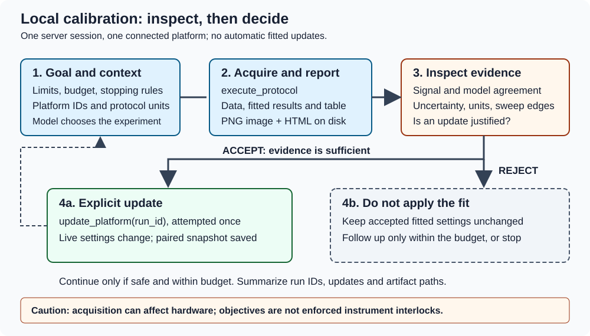
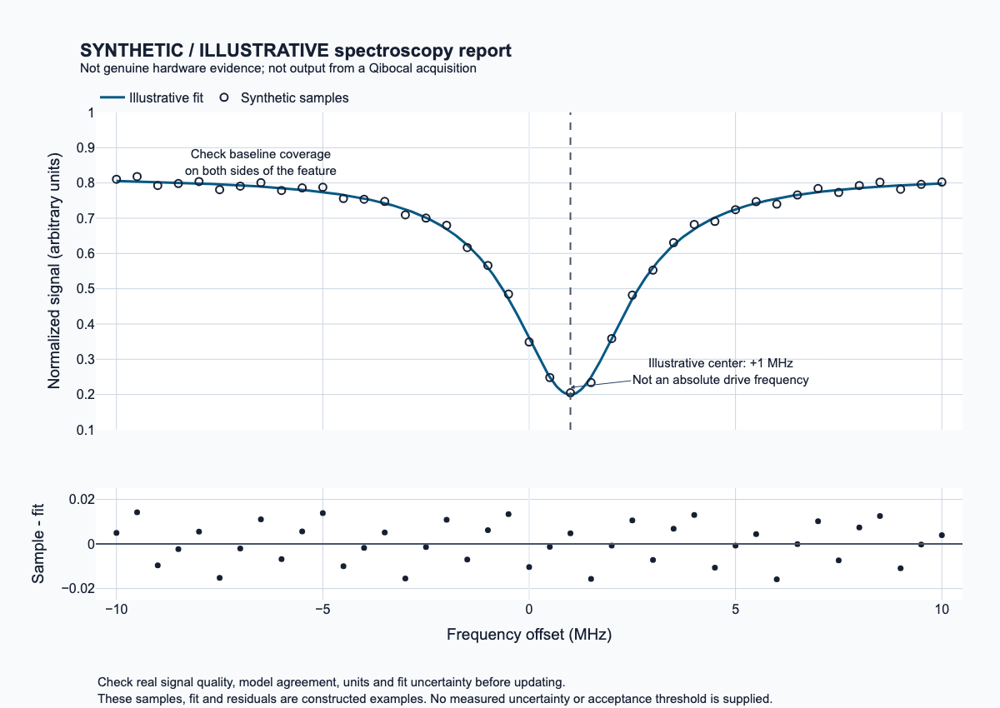

Local calibration: inspect before updating
==========================================

Goal
----

Run a bounded drive-frequency investigation, inspect its evidence and retain
an explicit record of whether an update was accepted. This tutorial assumes
an installed local platform, Chrome, hardware drivers, a vision-capable model
and an operator-approved instrument allocation.

   The inspection step separates acquiring evidence from accepting a fitted
   platform update. This original diagram describes control flow, not measured
   hardware performance.

1. Confirm the local setup
--------------------------

Complete the minimal setup in :doc:`../agent/installation` and confirm your
platform definitions, drivers, Chrome and model credentials are available.
No persistent configuration or separate MCP client is required.
This tutorial uses ``--no-config`` below to make direct local execution
explicit, even if you previously stored cluster settings.

2. Run a bounded objective
--------------------------

Check that the platform's target ID is actually ``0`` using your site's
platform definition. The agent reads platform context before planning.
The following numbers are examples, not recommendations for an arbitrary
device:

.. code-block:: sh

   qibocal-agent --no-config \
     --model openai:gpt-4.1 --platform YOUR_PLATFORM --output runs \
     "Investigate qubit 0's drive frequency with spectroscopy.
      Sweep no wider than 20 MHz, use drive amplitude at most 0.1
      and at most 100 shots. Run at most two protocols.
      Inspect plots and fit uncertainty before accepting any update.
      Reject a fit with insufficient evidence; stop on errors,
      exhausted budget or uncertainty requiring operator input.
      Summarize run IDs, accepted updates and artifact paths."

The agent owns one persistent server and hardware connection during this
direct-mode session. Each acquisition produces data and, where supported,
fitted results, tables and images. It does not automatically apply the fit.

3. Interpret the evidence
-------------------------

, not hardware evidence or a Qibocal acquisition.
   :width: 100%

   Synthetic, illustrative report picture generated with Plotly and Kaleido
   for this documentation. It is not output from a Qibocal acquisition and
   is not genuine hardware evidence.

The picture shows how to read a report, not how to accept this particular fit:

* A feature inside the sweep, with baseline visible on both sides, is more
  informative than a feature cut off at an edge. A wider sweep may be unsafe;
  keep any follow-up within the objective's approved range.
* Compare the samples with the fitted curve. Look for noise, drift, systematic
  disagreement or multiple features that the model does not explain.
  The lower panel shows sample-minus-fit residuals: a systematic pattern in
  real residuals can reveal disagreement that the main curve hides.
* Consult the actual fitting table and uncertainties; the illustration
  supplies no measured uncertainty or numerical acceptance threshold.
* Check units against the context. Here the horizontal axis is a frequency
  *offset* in MHz; that is not an absolute drive frequency.

If the real evidence is insufficient, leave fitted platform settings unchanged.
A second acquisition is allowed only within the budget. Model output and
synthetic data must never be treated as proof of successful hardware calibration.

4. Review the outcome and files
-------------------------------

Look for a final summary naming the protocols, run IDs, updates, artifact paths
and remaining uncertainty. Use the returned ``folder`` to inspect ``run.json``,
report HTML/PNG files and any saved per-run ``platform/`` snapshot. The shared
report lives at ``runs/sessions/<session_id>/``; its ``new_platform/`` holds
the current session state. The image returned over MCP is
real report content for the execution; a path alone is not required to view it.

An accepted update affects the live platform for subsequent acquisitions and
saves a snapshot without overwriting source platform files. Promoting that
snapshot to your authoritative platform definition is a separate manual
operation. See :doc:`../guides/artifacts` for file layout and
:doc:`../guides/safety` for failure recovery and stale runs.

Advanced: optional persistent defaults
--------------------------------------

For repeated sessions, store reviewed agent defaults instead of repeating
them on the command line:

.. code-block:: sh

   qibocal-mcp-config path
   qibocal-mcp-config show
   qibocal-mcp-config set agents.local.platform YOUR_PLATFORM
   qibocal-mcp-config set agents.local.model openai:gpt-4.1
   qibocal-mcp-config set agents.local.output runs
   qibocal-mcp-config set agents.local.objective "YOUR_BOUNDED_OBJECTIVE"
   qibocal-agent local

``show`` displays stored values, not effective defaults. Inspect any stored
``ssh``, ``partition`` or ``slurm_arg`` settings before treating a configured
launch as local. Named agents are isolated from the unnamed ``agent`` defaults.
For normal use, review :doc:`../guides/configuration` and omit ``--no-config``
only once stored defaults match your intended workflow.
