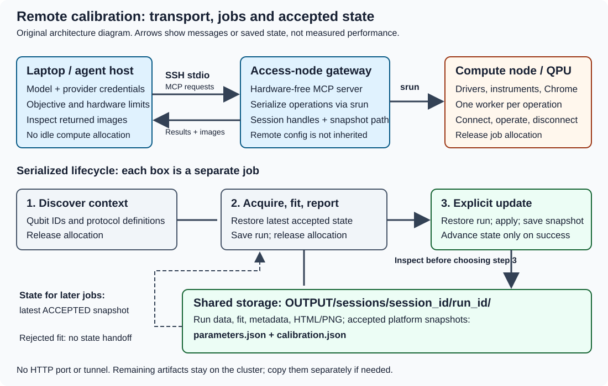

SSH and SLURM: calibrate without holding an idle allocation
===========================================================

Goal and prerequisites
----------------------

Keep the agent and model credentials on your laptop while a hardware-free
gateway on an access node dispatches one SLURM job per operation.
This follows Qibocal's
`interactive infrastructure <https://qibo.science/qibocal/stable/tutorials/interactive.html>`_.

First complete :doc:`../agent/installation` on the machine running the agent and confirm:

* Noninteractive SSH authentication works through your SSH configuration,
  including any ``ProxyJump``. Configure keys or an SSH agent beforehand.
* The managed Python environment, working directory, cached source snapshots
  and repository clones, platforms and output storage are accessible at
  identical absolute paths on access and compute nodes. Configure the access
  node's noninteractive ``XDG_CACHE_HOME`` to shared storage, for example
  ``/shared/YOUR_USER/cache``; choosing a shared ``--venv`` alone does not move
  the source/clone cache.
* The access node has ``python3`` 3.12/3.13, Git and ``pip``/``ensurepip``,
  ``uv`` or external ``pip>=22.3``. It needs no checkout or preinstalled server.
  Clone/package-index authentication and network access work on that node.
* Compute nodes can reach the instruments, and have Chrome and drivers.
* Your partition, account, resource requests and hardware limits are approved.

jected fits do not change that snapshot.
   :width: 100%

   Original topology and state-handoff diagram. No HTTP listener or tunnel is
   involved, and no compute allocation is held while the model inspects reports.

1. Check access without touching hardware
-----------------------------------------

Replace the placeholders and run:

.. code-block:: sh

   ssh -T -o BatchMode=yes ACCESS_NODE \
     'python3 --version && git --version && test -d /shared/calibration-work && test -w /shared/YOUR_USER/cache'

Create the shared working/cache directories through your site's normal setup
first. This checks login, bootstrap tools and shared directory availability.
Also confirm one of the installer routes above is available. It does not prove
compute-node path availability, instrument access or Chrome availability;
verify those through your site's normal allocation procedure. There is no
automatic compute-node provisioning or node-local staging.

Set driver environment variables on the access node using your site's supported
noninteractive setup, including ``XDG_CACHE_HOME`` if the default cache is not
shared. Repository roots supply remote ``QIBOLAB_PLATFORMS``; optional
``--platforms-dir`` paths precede them. Without explicit paths, inherited remote
platform paths follow them. Other driver settings are exported from the gateway
environment to SLURM. The laptop's environment, model credentials and
``SSH_AUTH_SOCK`` are not automatically forwarded for remote Git authentication.
See :doc:`../guides/networking`.

2. Launch the laptop agent
--------------------------

.. code-block:: sh

   export OPENAI_API_KEY=...
   qibocal-agent --no-config \
     --model openai:gpt-4.1 --platform YOUR_PLATFORM \
     --ssh ACCESS_NODE --partition PARTITION \
     --venv /shared/YOUR_USER/qibocal-mcp/env \
     --workdir /shared/calibration-work \
     --platform-repo 'https://github.com/YOUR_ORG/platforms.git#ref=COMMIT&subdirectory=platforms' \
     --dependency 'YOUR_DRIVER_PACKAGE==VERSION' \
     --output /shared/calibration-runs \
     --slurm-arg=--account=YOUR_ACCOUNT --slurm-arg=--time=00:15:00 \
     --timeout 7200 \
     "Calibrate qubit 0's drive frequency using spectroscopy.
      Sweep no wider than 20 MHz, use drive amplitude at most 0.1
      and at most 100 shots, if these are approved for this platform.
      Run at most two protocols. Inspect plots and fit uncertainty
      before accepting an update. Stop on errors or insufficient evidence.
      Summarize run IDs, updates, remaining uncertainty and cluster paths."

Replace the target and limits before executing; conditional wording is not a
safety check. ``--no-config`` makes this example independent of stored defaults.
Replace the repository, commit, subdirectory and Python driver requirement with
trusted site-specific values, or omit the subdirectory/dependency when unneeded.
You can repeat ``--platform-repo`` for additional platform roots in lookup order,
and ``--dependency`` for additional requirement specifications. Quote ``&`` in
repository fragments and URL-encode fragment values as needed.

The agent resolves the model provider first, then transfers the launching
installation's server source and metadata (from this checkout or installed
distribution metadata) over SSH and installs the server dependencies and
pinned Qibocal in the managed environment. It checks dependencies and imports
the server before launch. Configuration and model keys are not
transferred. Without ``--venv`` an SSH launch still manages an environment named
``qibocal-mcp``, but its default cache/env location must be shared for SLURM.
An existing environment is reused, not automatically deleted or recreated;
installation errors stop startup. Dependencies are additive: removing a
configured requirement does not uninstall it.

Clones are reused without automatic pull/fetch/reset on later launches. Pin
an actual commit to keep hardware definitions reproducible; choose a new ref
or explicitly review/maintain the cache to refresh. Requirements are discovered
at every checkout/subdirectory root and only the first matching selected platform
in the effective search paths. Local project references and includes are rebased
relative to their original requirements file. Packaged repository roots are
installed editable. All dependency
sources resolve together, with conflicts reported as errors; see
:doc:`../guides/configuration`. Chrome and system drivers remain site-managed.

``--timeout`` is a per-operation limit including queue wait, not a limit on the
entire objective. ``--slurm-arg=--time=00:15:00`` sets a scheduler limit rather
than replacing the MCP timeout.

The first context read submits a discovery job. Each protocol then gets a fresh
job that connects, acquires, fits, reports, disconnects and releases its
allocation. An accepted update is another job that restores the saved execution,
applies its results and saves a snapshot. Later jobs use the latest accepted
Qibolab parameters *and* Qibocal calibration, not the most recent rejected fit.
See :doc:`../guides/architecture` for the lifecycle.

Externally managed server alternative
~~~~~~~~~~~~~~~~~~~~~~~~~~~~~~~~~~~~~~

If your site already provides a shared server interpreter, select it explicitly:

.. code-block:: sh

   qibocal-agent --no-config \
     --model openai:gpt-4.1 --platform YOUR_PLATFORM \
     --ssh ACCESS_NODE --partition PARTITION \
     --server-python /shared/qibocal-agent/.venv/bin/python \
     --workdir /shared/qibocal-agent \
     --platforms-dir /shared/qibolab-platforms \
     --output /shared/calibration-runs \
     --slurm-arg=--account=YOUR_ACCOUNT --slurm-arg=--time=00:15:00 \
     --timeout 7200 "YOUR_BOUNDED_OBJECTIVE"

Replace the objective with reviewed hardware limits and a stopping budget.
``--server-python`` bypasses automatic environment/core-server installation;
that interpreter must already contain the server and its dependencies. Check
importability without hardware using:

.. code-block:: sh

   ssh -T -o BatchMode=yes ACCESS_NODE \
     'cd /shared/qibocal-agent && .venv/bin/python -m qibocal_mcp.server --help'

Do not combine ``--server-python`` with ``--venv``, including stored settings.
Repository/dependency options can also be used with this alternative, but they
intentionally install into the selected existing interpreter. Use managed
``--venv`` isolation unless that modification is approved.

3. Optional persistent cluster defaults
---------------------------------------

Store reviewed agent settings rather than repeating paths every time:

.. code-block:: sh

   qibocal-mcp-config set agents.myremote.platform YOUR_PLATFORM
   qibocal-mcp-config set agents.myremote.model openai:gpt-4.1
   qibocal-mcp-config set agents.myremote.objective "YOUR_BOUNDED_OBJECTIVE"
   qibocal-mcp-config set agents.myremote.ssh ACCESS_NODE
   qibocal-mcp-config set agents.myremote.partition PARTITION
   qibocal-mcp-config set agents.myremote.venv /shared/YOUR_USER/qibocal-agent/env
   qibocal-mcp-config set agents.myremote.workdir /shared/calibration-work
   qibocal-mcp-config set agents.myremote.platform_repo '["https://github.com/YOUR_ORG/platforms.git#ref=COMMIT&subdirectory=platforms"]'
   qibocal-mcp-config set agents.myremote.dependency '["YOUR_DRIVER_PACKAGE==VERSION"]'
   qibocal-mcp-config set agents.myremote.output /shared/calibration-runs
   qibocal-mcp-config set agents.myremote.timeout 7200
   qibocal-mcp-config set agents.myremote.slurm_arg '["--account=quantum", "--time=00:15:00"]'
   qibocal-mcp-config show

Use your actual account, not the illustrative ``quantum`` value. After reviewing
the file, ``qibocal-agent myremote`` uses those settings and the saved
objective. Explicit CLI settings override the named entry. The server itself
reads no configuration file and receives fully resolved flags, so configuration
stored on the access node cannot silently inject another platform or partition.
The same named entry also works for interactive use:
``qibocal-mcp-remote myremote`` serves this exact deployment to any MCP client
(see :doc:`../agent/interactive`), and ``qibocal-report-server myremote``
browses its reports.
Unset an existing ``agents.myremote.server_python`` before storing
``agents.myremote.venv``.
CLI repository/dependency lists replace the entire corresponding configured
list. ``get`` returns arrays as JSON, and ``unset`` restores built-in defaults;
see :doc:`../guides/configuration`.

4. Inspect results and retain cluster artifacts
-----------------------------------------------

Images and results return over MCP and can be inspected on the laptop.
Artifacts remain under
``OUTPUT/sessions/<session_id>/data/<protocol>-<iteration>/`` on the cluster.
All executions share the session's standard Qibocal report.
Copying the whole session retains metadata, execution order and platform state;
for example:

.. code-block:: sh

   scp -r ACCESS_NODE:/shared/calibration-runs/sessions/SESSION_ID ./retained-report

Use the actual IDs and follow your site's data handling policy. Do not retry
failed acquisitions or partially applied updates blindly. Timeout/cancellation
and allocation release depend on SLURM/site signal handling; see
:doc:`../guides/safety`.

Other agent locations
---------------------

**Agent on the access node:** use the managed launch command without ``--ssh``,
retaining ``--venv`` for managed provisioning. Unlike SSH mode, a local agent
does not automatically manage an environment when ``--venv`` is omitted; it
uses its current interpreter unless ``--server-python`` selects another.
Install the agent extra and provide credentials on that node.

**Agent on an allocated compute node:** first acquire an allocation through
your site's procedure, then omit ``--ssh``, ``--partition`` and ``--slurm-arg``.
This is direct mode with one persistent hardware connection and no nested jobs.
Use ``--no-config`` or a reviewed configuration file so stored queue settings
do not accidentally re-enable dispatch.
